# Skies of Arcadia Legends — HD Texture Pack (Dolphin Mod)

[](https://github.com/shoopkid/Skies-of-Arcadia-Legends-HD-Textures-Pack/releases)
[](https://dolphin-emu.org/)
[](https://gametdb.com/GameCube/GEAE01)
[](LICENSE)

> **Originally by Bighead & frozenwings, continued and curated by Shoopkid.**  
> A clean, high-quality, zero-stutter HD texture overhaul for the GameCube classic *Skies of Arcadia Legends*, tailored specifically for Dolphin Emulator.

---

## Downloads

All texture packages are available for download as modular `.7z` archives on the **[GitHub Releases Page](https://github.com/shoopkid/Skies-of-Arcadia-Legends-HD-Textures-Pack/releases/tag/v0.2.0)**:

| Package | Archive Name | Download Link | Description |
| :--- | :--- | :--- | :--- |
| **01. UI** | `01_SoAL_HD_UI_v0.2.0.7z` | [Download](https://github.com/shoopkid/Skies-of-Arcadia-Legends-HD-Textures-Pack/releases/download/v0.2.0/01_SoAL_HD_UI_v0.2.0.7z) | Menus, text fonts, HUD command wheels, compass, crew portraits, dialogue boxes (25 MB) |
| **02. Characters** | `02_SoAL_HD_Characters_v0.2.0.7z` | [Download](https://github.com/shoopkid/Skies-of-Arcadia-Legends-HD-Textures-Pack/releases/download/v0.2.0/02_SoAL_HD_Characters_v0.2.0.7z) | All party members, costumes, weapons, NPCs, Armada, enemies, bosses, and Gigas (1.00 GB) |
| **03a. Environment — World & Ships** | `03a_SoAL_HD_Environment_Overworld_Ships_v0.2.0.7z` | [Download](https://github.com/shoopkid/Skies-of-Arcadia-Legends-HD-Textures-Pack/releases/download/v0.2.0/03a_SoAL_HD_Environment_Overworld_Ships_v0.2.0.7z) | Airships (Delphinus, Little Jack, etc.), skyboxes, weather, moons, discoveries, battle arenas (801 MB) |
| **03b. Environment — Locations (Disc 1, Part 1)** | `03b_SoAL_HD_Environment_Locations_Disc1_Part1_v0.2.0.7z` | [Download](https://github.com/shoopkid/Skies-of-Arcadia-Legends-HD-Textures-Pack/releases/download/v0.2.0/03b_SoAL_HD_Environment_Locations_Disc1_Part1_v0.2.0.7z) | Pirate Isle, Shrine Island, Sailor's Island, Valua City/Catacombs, Maramba, Pyrynn, Horteka, Rixis (1.77 GB) |
| **03c. Environment — Locations (Disc 1, Part 2)** | `03c_SoAL_HD_Environment_Locations_Disc1_Part2_v0.2.0.7z` | [Download](https://github.com/shoopkid/Skies-of-Arcadia-Legends-HD-Textures-Pack/releases/download/v0.2.0/03c_SoAL_HD_Environment_Locations_Disc1_Part2_v0.2.0.7z) | Nasrad, Daccat's Island, Grand Fortress, Dark Rift, Yafutoma, Mt. Kazai, World Flight (1.58 GB) |
| **03d. Environment — Locations (Disc 2)** | `03d_SoAL_HD_Environment_Locations_Disc2_v0.2.0.7z` | [Download](https://github.com/shoopkid/Skies-of-Arcadia-Legends-HD-Textures-Pack/releases/download/v0.2.0/03d_SoAL_HD_Environment_Locations_Disc2_v0.2.0.7z) | Crescent Isle HQ upgrades, Lands of Ice, Glacia, Great Silver Shrine, Hydra, Soltis (1.35 GB) |
| **04. Special Effects** | `04_SoAL_HD_Effects_v0.2.0.7z` | [Download](https://github.com/shoopkid/Skies-of-Arcadia-Legends-HD-Textures-Pack/releases/download/v0.2.0/04_SoAL_HD_Effects_v0.2.0.7z) | Magic spells (all 6 elements), explosions, particle flares, weapon trails, hit sparks (208 MB) |
| **05. Cutscene Artwork** | `05_SoAL_HD_Cutscene_Artwork_v0.2.0.7z` | [Download](https://github.com/shoopkid/Skies-of-Arcadia-Legends-HD-Textures-Pack/releases/download/v0.2.0/05_SoAL_HD_Cutscene_Artwork_v0.2.0.7z) | Full-screen story illustrations, Silvite flashbacks, opening sequence paintings (38 MB) |

---

## Overview

This pack aims to provide a clean, high-quality replacement for uncurated "AI slop" texture packs that have circulated the community, prioritizing careful manual curation over raw, unchecked batch generation.

Crucially, all textures have been fully converted into **Microsoft DirectX BC7 DDS** format. Unlike standard PNG texture packs that cause micro-stutters and consume large amounts of RAM while your CPU decodes them, these DDS files bypass the CPU completely and stream instantly into your GPU's VRAM with Dolphin prefetching.

The result is a visually stunning experience with **zero stuttering** and highly efficient performance.

---

## Comparison Gallery

Here is a side-by-side showcase comparing the original GameCube textures with the new high-definition replacements:

### Vyse
| Original GameCube | HD Texture Pack (4x BC7 DDS) |
| :---: | :---: |
| 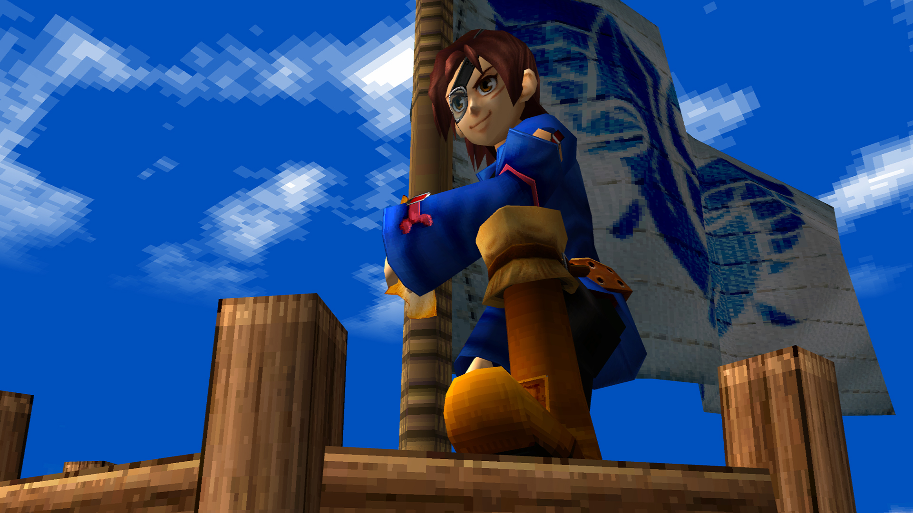 | 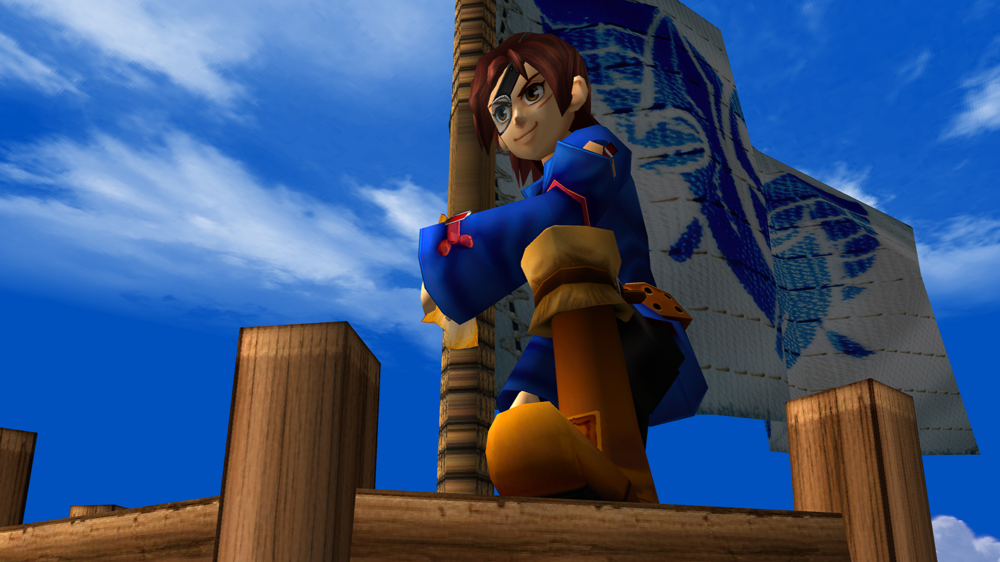 |

### Sailor's Island
| Original GameCube | HD Texture Pack (4x BC7 DDS) |
| :---: | :---: |
| 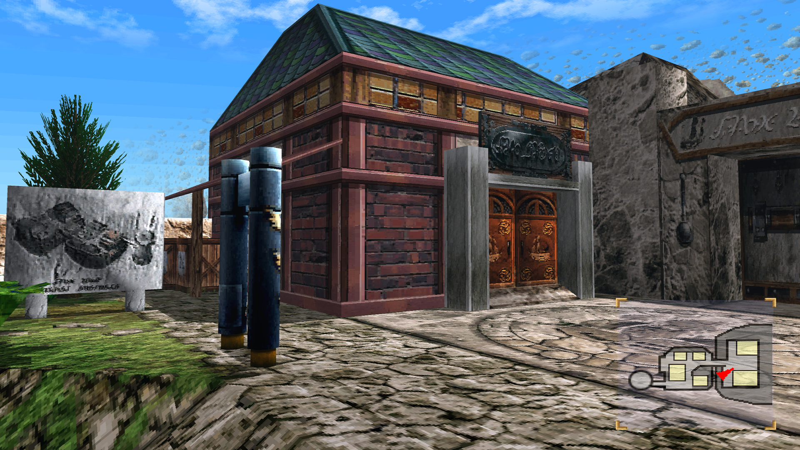 | 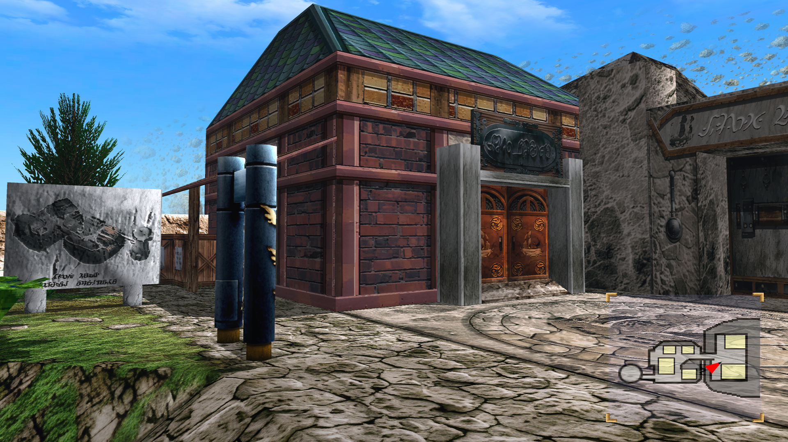 |

### Ship Battle UI
| Original GameCube | HD Texture Pack (4x BC7 DDS) |
| :---: | :---: |
| 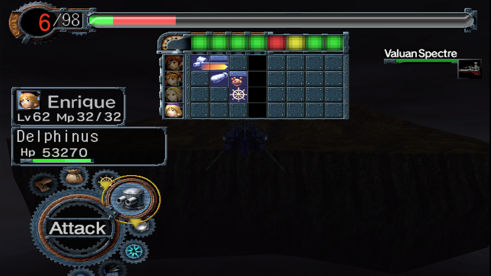 | 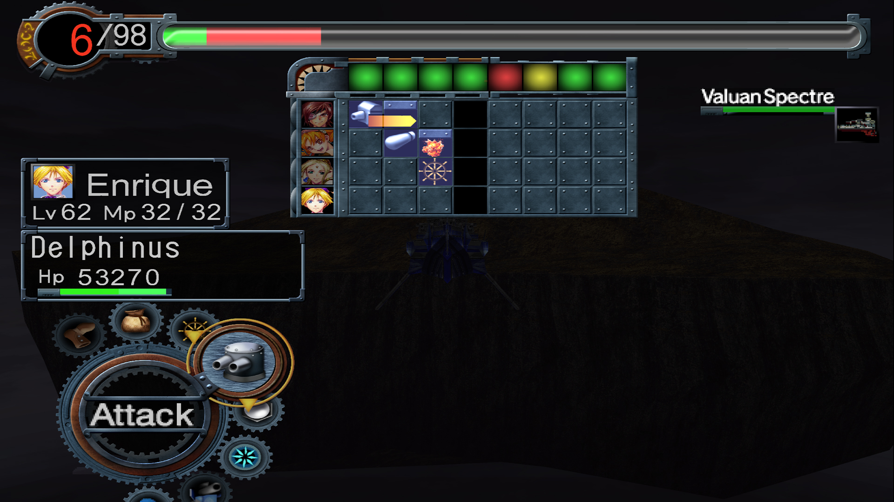 |

### Characters and Environment
| Original GameCube | HD Texture Pack (4x BC7 DDS) |
| :---: | :---: |
| 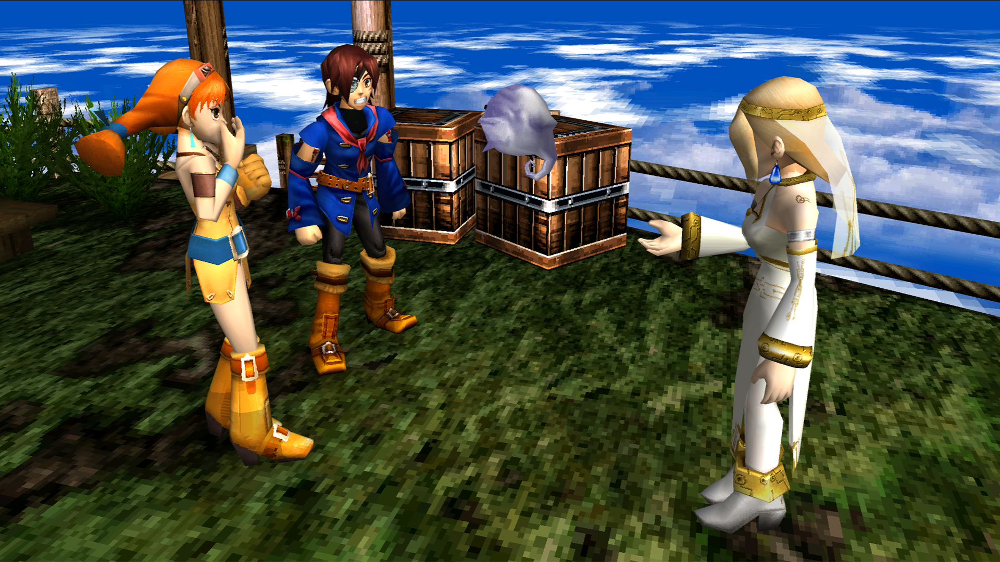 | 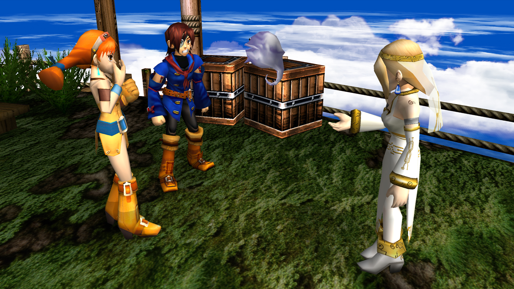 |

### Overworld & Skybox
| Original GameCube | HD Texture Pack (4x BC7 DDS) |
| :---: | :---: |
| 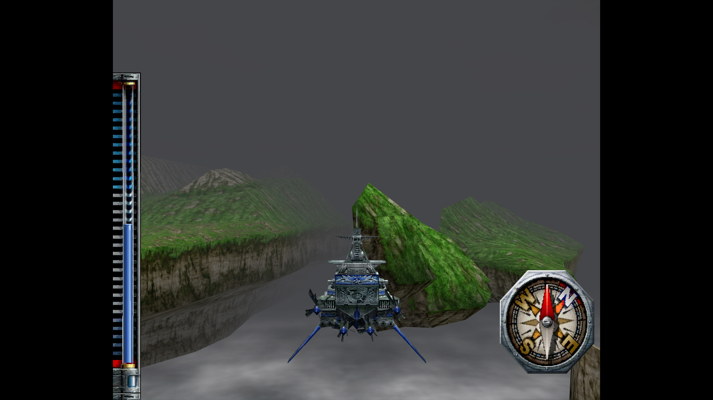 | 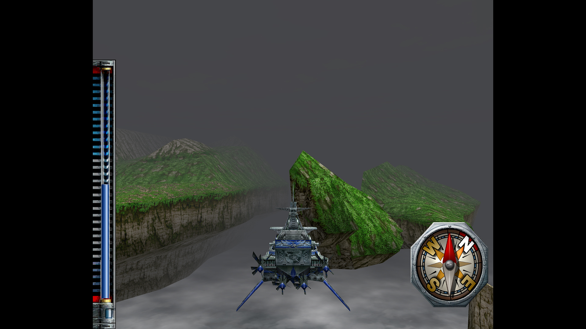 |

### Alfonso & Imperial Uniforms
| Original GameCube | HD Texture Pack (4x BC7 DDS) |
| :---: | :---: |
| 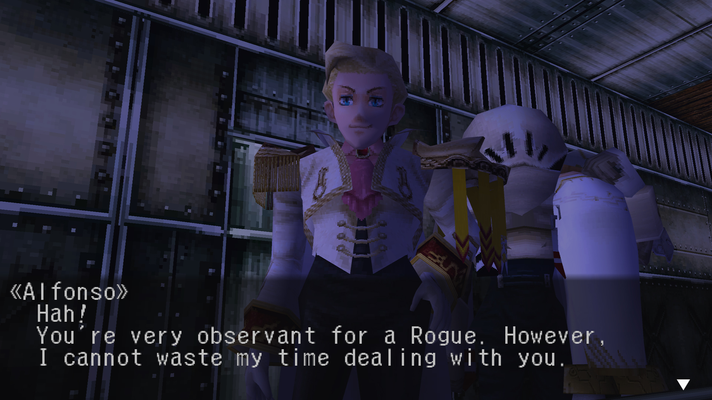 |  |

### Battle HUD
| Original GameCube | HD Texture Pack (4x BC7 DDS) |
| :---: | :---: |
| 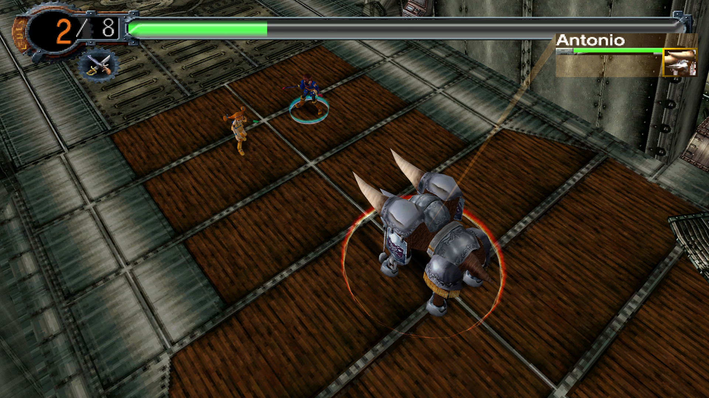 | 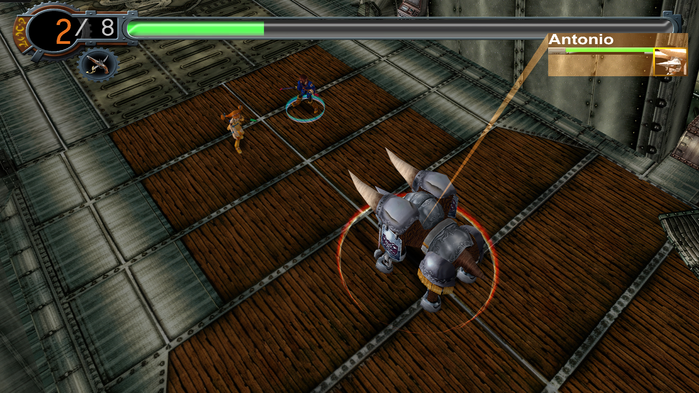 |

---

## The Upscale Process

All texture assets are 4x their original size and perfectly optimized:

* **UI:** Missing or compressed UI assets from the original Bighead and frozenwings project are recreated and redrawn from scratch for pixel-perfect clarity.
* **Character Faces:** Upscaled using Topaz Gigapixel AI's *'Redefine'* generative model at 2x upscale, then *'High fidelity'* model at 2x upscale. Textures are then carefully airbrushed in Photoshop to remove artifacts and enhance detail.
* **Character Clothing:** Upscaled using Topaz Gigapixel AI's *'High fidelity'* model at 4x upscale. Textures are then edited in Photoshop to enhance localized detail.
* **Environment:** Environment assets are upscaled using Topaz Gigapixel AI's *'Recover'* generative model.
* **Special Effects:** Special effect textures (clouds, fire, shadows, lighting) are upscaled 4x in Adobe Photoshop and an appropriate Gaussian Blur filter is applied to smooth out harsh pixelation.

---

## How to Install on Dolphin Emulator

Follow these simple steps for zero-fuss, stutter-free performance:

### 1. Download & Extract
* Download your desired `.7z` packages from the table above or the [Releases page](https://github.com/shoopkid/Skies-of-Arcadia-Legends-HD-Textures-Pack/releases).
* Select all downloaded `.7z` files, right-click, and choose **7-Zip → Extract Here**.
* You will see a single folder named **`GEA`** (the GameCube ID for *Skies of Arcadia Legends*).

### 2. Move to Dolphin's Textures Directory
Copy the extracted **`GEA`** folder and paste it into Dolphin's custom textures directory:
* **Windows:** `Documents\Dolphin Emulator\Load\Textures\`
* **macOS:** `~/Library/Application Support/Dolphin/Load/Textures/`
* **Linux:** `~/.local/share/dolphin-emu/Load/Textures/`

The final path must look like this:
```text
Load/Textures/GEA/
  ├── Characters/
  ├── Cutscene Artwork/
  ├── Environment/
  ├── Special Effects/
  └── UI/
```

### 3. Enable Settings in Dolphin
1. Open Dolphin Emulator and click **Graphics**.
2. Go to the **Advanced** tab:
   * Under **Utility**, check **Load Custom Textures**.
   * Under **Utility**, check **Prefetch Custom Textures**. *(Crucial: Because these files are optimized BC7 DDS, prefetching instantly loads them into your GPU's VRAM on startup, completely eliminating in-game hitching).*

### Recommended Enhancements
* **Graphics → General:** Backend set to **Vulkan** or **Direct3D 12**.
* **Graphics → Enhancements:** Internal Resolution set to **3x (1080p)** or **4x (1440p)**.
* **Graphics → Enhancements:** Anisotropic Filtering set to **8x** or **16x**.

---

## Credits & Thanks

* **SEGA & Overworks:** For creating the timeless masterpiece that is *Skies of Arcadia*.
* **Bighead & frozenwings:** For creating the original, foundational Dolphin HD texture project:  
  [https://forums.dolphin-emu.org/Thread-skies-of-arcadia-hd-v0-06-june-27-2020](https://forums.dolphin-emu.org/Thread-skies-of-arcadia-hd-v0-06-june-27-2020)
* **Shoopkid:** Continued, expanded, curated, and optimized into BC7 DDS.
* **Dolphin Emulator Development Team:** For the industry-leading emulator and custom texture engine.
