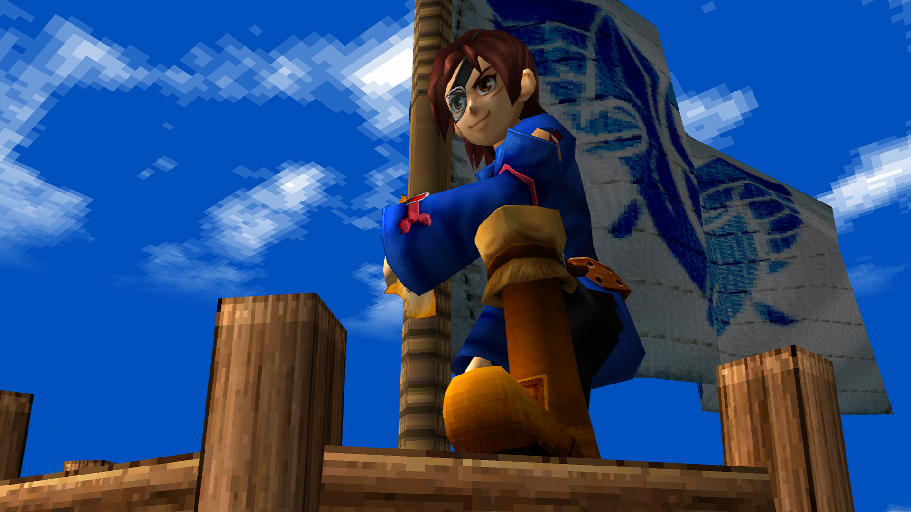
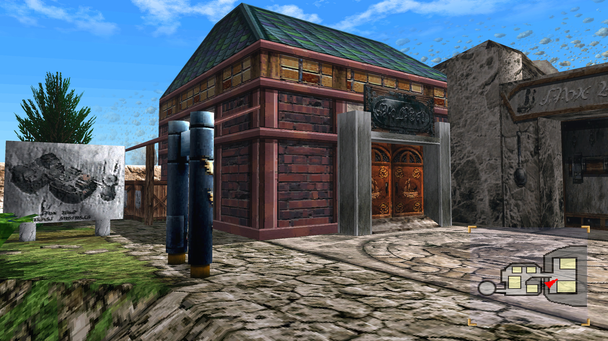
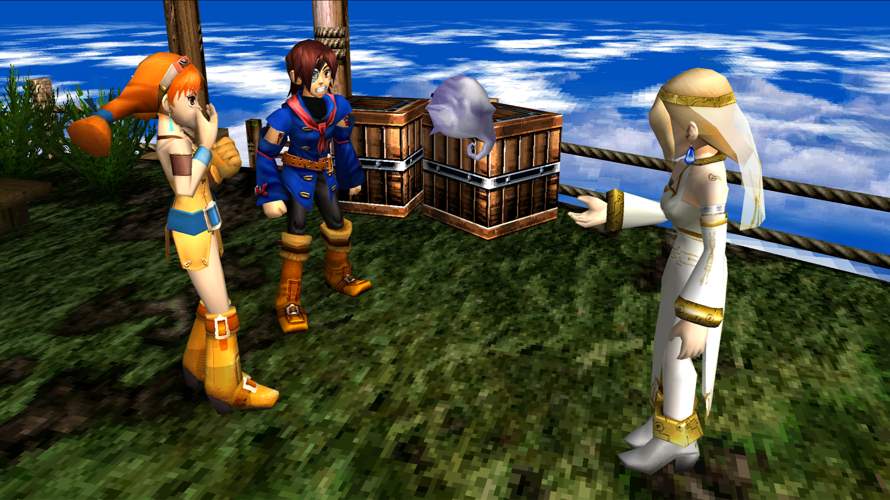
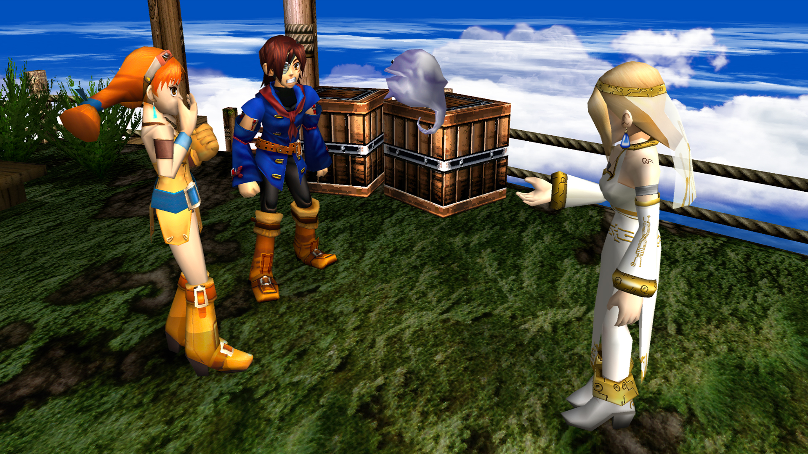
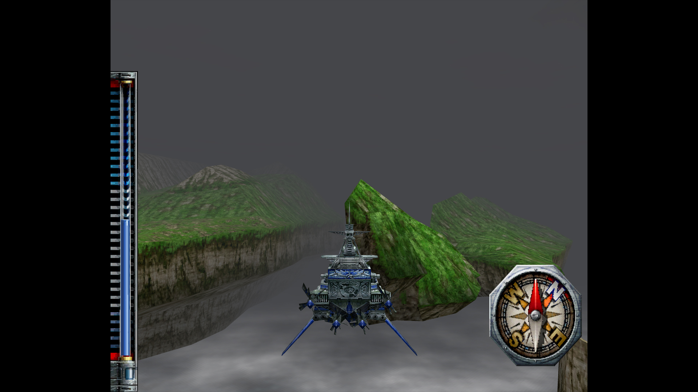
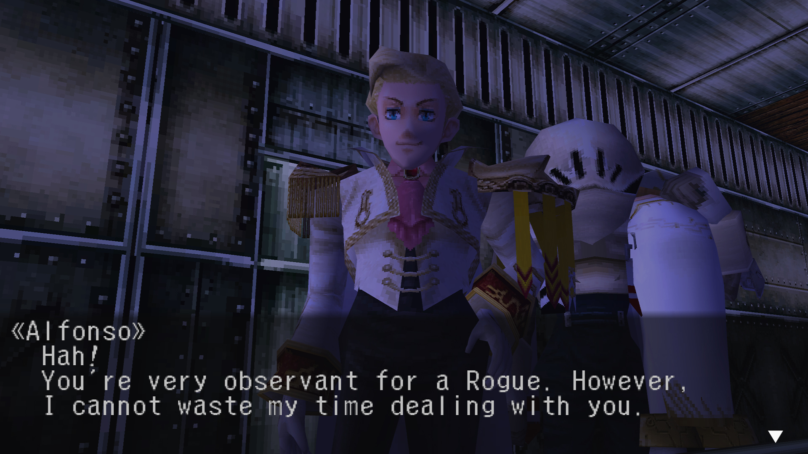
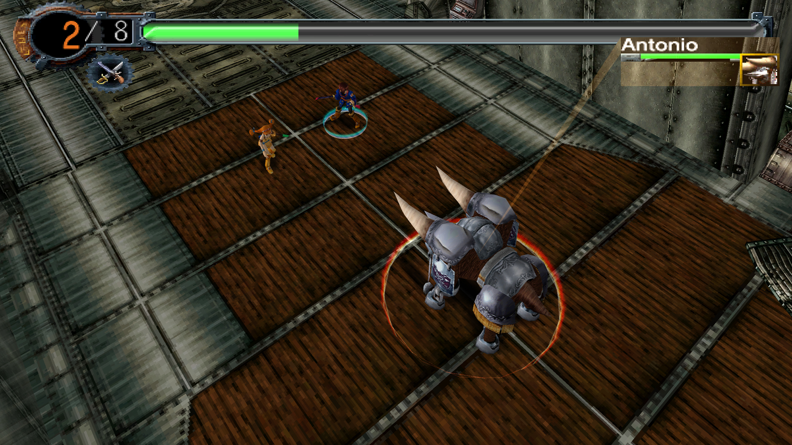

# Skies of Arcadia Legends — HD Texture Pack (Dolphin Mod)

[](https://github.com/shoopkid/Skies-of-Arcadia-Legends-HD-Textures-Pack/releases)
[](https://dolphin-emu.org/)
[](https://gametdb.com/GameCube/GEAE01)
[](LICENSE)

> **Originally by Bighead & frozenwings, continued, expanded, and curated by Shoopkid.**  
> A comprehensive, zero-stutter 4x HD texture overhaul for the GameCube classic *Skies of Arcadia Legends*, tailored specifically for Dolphin Emulator.

---

## Downloads (Version 0.3.0)

All texture packages are available for download as modular `.7z` archives on the **[GitHub Releases Page](https://github.com/shoopkid/Skies-of-Arcadia-Legends-HD-Textures-Pack/releases/tag/v0.3.0)**:

| Package | Archive Name | Download Link | Description |
| :--- | :--- | :--- | :--- |
| **01. Characters & Enemies** | `01_SoAL_HD_Characters_and_Enemies_v0.3.0.7z` | [Download](https://github.com/shoopkid/Skies-of-Arcadia-Legends-HD-Textures-Pack/releases/download/v0.3.0/01_SoAL_HD_Characters_and_Enemies_v0.3.0.7z) | Playable party members, battle costumes, weapons, Admirals, NPCs, world enemies, bounties, Gigas, and bosses (1.17 GB) |
| **02a. Towns & Ports (Part 1)** | `02a_SoAL_HD_Towns_and_Ports_Part1_v0.3.0.7z` | [Download](https://github.com/shoopkid/Skies-of-Arcadia-Legends-HD-Textures-Pack/releases/download/v0.3.0/02a_SoAL_HD_Towns_and_Ports_Part1_v0.3.0.7z) | Pirate Isle, Sailor's Island, Lower City Valua, Maramba City, Horteka, and Nasrad (1.26 GB) |
| **02b. Towns & Ports (Part 2)** | `02b_SoAL_HD_Towns_and_Ports_Part2_v0.3.0.7z` | [Download](https://github.com/shoopkid/Skies-of-Arcadia-Legends-HD-Textures-Pack/releases/download/v0.3.0/02b_SoAL_HD_Towns_and_Ports_Part2_v0.3.0.7z) | Crescent Isle HQ, Esperanza, Yafutoma, Tenkou Island, and Great Silver Shrine (1.30 GB) |
| **03a. Dungeons & Ruins (Part 1)** | `03a_SoAL_HD_Dungeons_and_Ruins_Part1_v0.3.0.7z` | [Download](https://github.com/shoopkid/Skies-of-Arcadia-Legends-HD-Textures-Pack/releases/download/v0.3.0/03a_SoAL_HD_Dungeons_and_Ruins_Part1_v0.3.0.7z) | Alfonso's Ship, Shrine Island, Valuan Catacombs, Upper City, Temple of Pyrynn, Moonstone Mountain, Rixis, and Daccat's Island (1.12 GB) |
| **03b. Dungeons & Ruins (Part 2)** | `03b_SoAL_HD_Dungeons_and_Ruins_Part2_v0.3.0.7z` | [Download](https://github.com/shoopkid/Skies-of-Arcadia-Legends-HD-Textures-Pack/releases/download/v0.3.0/03b_SoAL_HD_Dungeons_and_Ruins_Part2_v0.3.0.7z) | Grand Fortress, Mt. Kazai, The Dark Rift, Glacia, Maw of Tartas, Dangral Island, The Vortex, The Hydra, and Soltis (1.40 GB) |
| **04. Ships & Ship Battles** | `04_SoAL_HD_Ships_and_Ship_Battles_v0.3.0.7z` | [Download](https://github.com/shoopkid/Skies-of-Arcadia-Legends-HD-Textures-Pack/releases/download/v0.3.0/04_SoAL_HD_Ships_and_Ship_Battles_v0.3.0.7z) | Delphinus, Little Jack, Albatross, Armada vessels, gunboats, pirate ships, bridge interiors, and ship combat stages (597 MB) |
| **05. Overworld** | `05_SoAL_HD_Overworld_v0.3.0.7z` | [Download](https://github.com/shoopkid/Skies-of-Arcadia-Legends-HD-Textures-Pack/releases/download/v0.3.0/05_SoAL_HD_Overworld_v0.3.0.7z) | Skyboxes, cloud layers, landmasses, floating islands, discoveries, and sky rifts (142 MB) |
| **06. Battle Arenas & Special Effects** | `06_SoAL_HD_Battle_Arenas_and_Effects_v0.3.0.7z` | [Download](https://github.com/shoopkid/Skies-of-Arcadia-Legends-HD-Textures-Pack/releases/download/v0.3.0/06_SoAL_HD_Battle_Arenas_and_Effects_v0.3.0.7z) | Combat arenas, magic spells (all 6 Moon elements), S-Crafts, weapon trails, cannon bursts, and explosion particles (941 MB) |
| **07. UI, Menus & Fonts** | `07_SoAL_HD_UI_Menus_and_Fonts_v0.3.0.7z` | [Download](https://github.com/shoopkid/Skies-of-Arcadia-Legends-HD-Textures-Pack/releases/download/v0.3.0/07_SoAL_HD_UI_Menus_and_Fonts_v0.3.0.7z) | Dialogue fonts, compass, HUD command wheels, party status screens, crew cards, and shop menus (41 MB) |
| **08. Cutscenes & Ending** | `08_SoAL_HD_Cutscenes_and_Ending_v0.3.0.7z` | [Download](https://github.com/shoopkid/Skies-of-Arcadia-Legends-HD-Textures-Pack/releases/download/v0.3.0/08_SoAL_HD_Cutscenes_and_Ending_v0.3.0.7z) | Intro Movies A & B, story flashback artwork, mid-ocean events, endgame gauntlet, and epilogue (811 MB) |

---

## Overview

Version 0.3.0 achieves 100% complete coverage across all **31,010 textures** extracted directly from the internal archives (`.mld` and `.mlk`) of the GameCube disc image.

All textures have been fully converted into **Microsoft DirectX BC7 DDS** format with full hardware mipmaps (`-m 0` / `-m 1`). Unlike standard PNG texture packs that cause micro-stuttering while your CPU decodes images at runtime, BC7 DDS textures bypass CPU decoding and load directly into GPU VRAM using Dolphin's custom texture prefetching pipeline.

### Highlights in v0.3.0
* **100% GameCube ISO Coverage**: Every character, ship, town, dungeon, overworld continent, battle arena, and cutscene asset from the raw disc image is fully upscaled and curated.
* **Alpha Channel & Ghost Haze Audit**: Systematic removal of low-alpha edge fringing ($1 \le \alpha \le 25$) to eliminate gray bounding-box outlines on character cutouts and foliage.
* **Standardized Atmospheric Pipeline**: Transparent overlays (clouds, smoke, mist, fog, and heat haze) upscaled with proportional Gaussian blur strictly on the alpha channel to preserve soft gradients without pixel stepping.
* **Runtime GPU Textures**: Dynamic Format 8 (C4, 4-bit paletted) textures generated during endgame bosses, ship battles, and Intro Movie A extracted and remastered with dual `_arb.dds` compatibility aliases.

---

## Comparison Gallery

Here is a side-by-side showcase comparing the original GameCube textures with the new high-definition replacements:

### Vyse
| Original GameCube | HD Texture Pack (4x BC7 DDS) |
| :---: | :---: |
|  |  |

### Sailor's Island
| Original GameCube | HD Texture Pack (4x BC7 DDS) |
| :---: | :---: |
|  |  |

### Ship Battle UI
| Original GameCube | HD Texture Pack (4x BC7 DDS) |
| :---: | :---: |
|  |  |

### Characters and Environment
| Original GameCube | HD Texture Pack (4x BC7 DDS) |
| :---: | :---: |
|  |  |

### Overworld & Skybox
| Original GameCube | HD Texture Pack (4x BC7 DDS) |
| :---: | :---: |
|  |  |

### Alfonso & Imperial Uniforms
| Original GameCube | HD Texture Pack (4x BC7 DDS) |
| :---: | :---: |
|  |  |

### Battle HUD
| Original GameCube | HD Texture Pack (4x BC7 DDS) |
| :---: | :---: |
|  |  |

---

## How to Install on Dolphin Emulator

### 1. Download & Extract
* Download the desired `.7z` packages from the table above or the [Releases page](https://github.com/shoopkid/Skies-of-Arcadia-Legends-HD-Textures-Pack/releases).
* Select the downloaded `.7z` files, right-click, and choose **7-Zip → Extract Here**.
* All archives unpack into a unified **`GEA`** directory (the GameCube title ID for *Skies of Arcadia Legends*).

### 2. Move to Dolphin's Textures Directory
Copy or move the extracted **`GEA`** folder into Dolphin's texture load path:
* **Windows:** `Documents\Dolphin Emulator\Load\Textures\`
* **macOS:** `~/Library/Application Support/Dolphin/Load/Textures/`
* **Linux:** `~/.local/share/dolphin-emu/Load/Textures/`

The folder structure inside `Load/Textures/` will look like this:
```text
Load/Textures/GEA/
  ├── 01 - Characters & Enemies/
  ├── 02 - Towns & Ports/
  ├── 03 - Dungeons & Ruins/
  ├── 04 - Ships & Ship Battles/
  ├── 05 - Overworld/
  ├── 06 - Battle Arenas & Effects/
  ├── 07 - UI, Menus & Fonts/
  └── 08 - Cutscenes & Ending/
```

### 3. Configure Dolphin Settings
1. Open Dolphin Emulator and click **Graphics**.
2. On the **Advanced** tab:
   * Check **Load Custom Textures**.
   * Check **Prefetch Custom Textures** *(Preloads BC7 DDS directly into GPU VRAM on startup to eliminate runtime hitching).*
3. On the **Enhancements** tab:
   * Internal Resolution: **3x (1080p)**, **4x (1440p)**, or **5x (4K)**.
   * Anisotropic Filtering: **8x** or **16x**.
   * Check **Arbitrary Mipmap Detection**.
   * Check **Force 24-Bit Color**.
   * Check **Disable Copy Filter**.
   * Uncheck **Disable Fog** *(ensures in-game depth mist and fog render correctly).*
4. On the **General** tab:
   * Backend: **Vulkan** or **Direct3D 12**.

---

## Credits & Thanks

* **SEGA & Overworks:** Original game development.
* **Bighead & frozenwings:** Foundational Dolphin HD texture project (2020).
* **Shoopkid:** Raw ISO dump extraction, 4x upscaling, curation, QA auditing, and BC7 DDS optimization.
* **Dolphin Emulator Development Team:** Texture replacement engine and prefetch pipeline.
