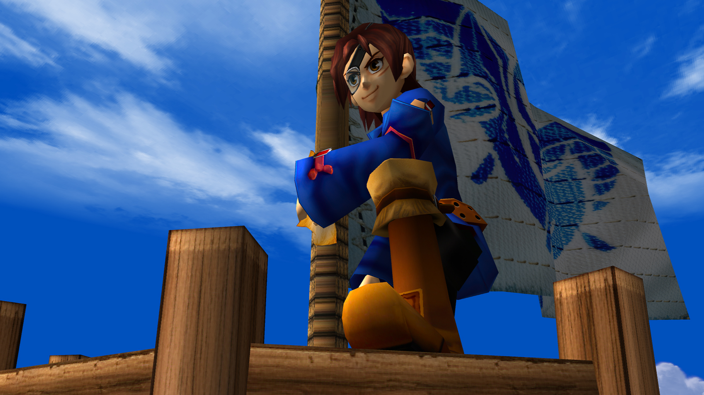
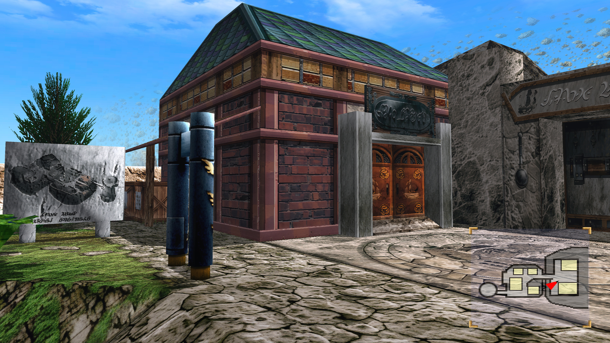
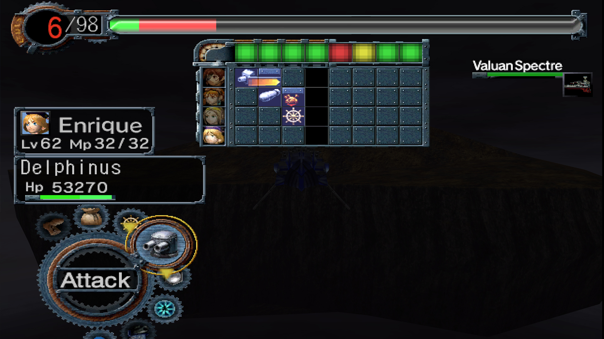
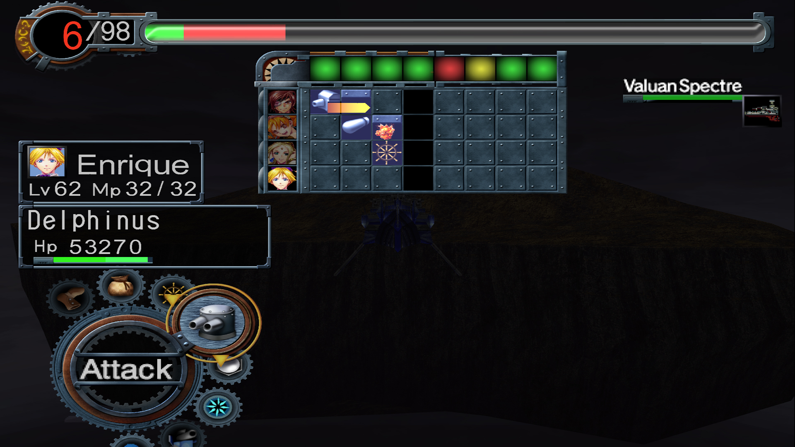
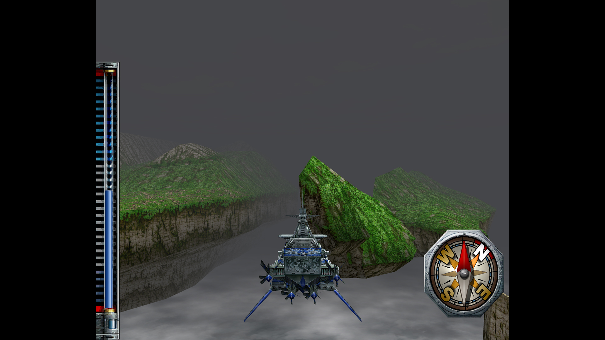
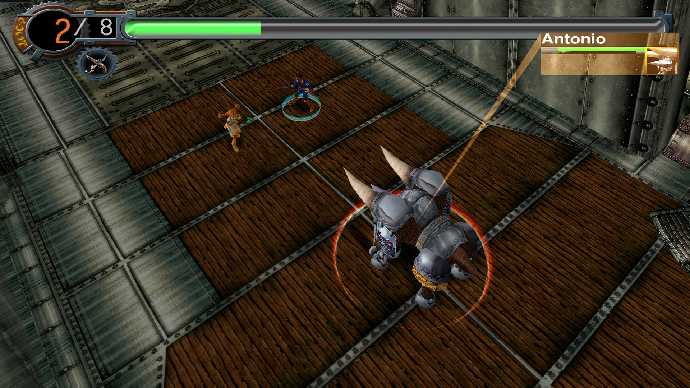

# Skies of Arcadia Legends — HD Texture Pack (Dolphin Mod)

[](https://github.com/shoopkid/Skies-of-Arcadia-Legends-HD-Textures-Pack/releases)
[](https://dolphin-emu.org/)
[](https://gametdb.com/GameCube/GEAE01)
[](LICENSE)

> **Originally by Bighead & frozenwings, continued, expanded, and curated by Shoopkid.**  
> A comprehensive, zero-stutter 4x HD texture overhaul for the GameCube classic *Skies of Arcadia Legends*, tailored specifically for Dolphin Emulator.

---

## Downloads (Version 0.3.1)

All texture packages are available for download as modular `.7z` archives on the **[GitHub Releases Page](https://github.com/shoopkid/Skies-of-Arcadia-Legends-HD-Textures-Pack/releases/tag/v0.3.1)**:

| Package | Archive Name | Download Link | Description |
| :--- | :--- | :--- | :--- |
| **01. Characters & Enemies** | `01_SoAL_HD_Characters_and_Enemies_v0.3.1.7z` | [Download](https://github.com/shoopkid/Skies-of-Arcadia-Legends-HD-Textures-Pack/releases/download/v0.3.1/01_SoAL_HD_Characters_and_Enemies_v0.3.1.7z) | Playable party members, battle costumes, weapons, Admirals, NPCs, world enemies, bounties, Gigas, and bosses (1.38 GB) |
| **02a. Towns & Ports (Part 1)** | `02a_SoAL_HD_Towns_and_Ports_Part1_v0.3.1.7z` | [Download](https://github.com/shoopkid/Skies-of-Arcadia-Legends-HD-Textures-Pack/releases/download/v0.3.1/02a_SoAL_HD_Towns_and_Ports_Part1_v0.3.1.7z) | Pirate Isle, Sailor's Island, Lower City Valua, Maramba City, Horteka, and Nasrad (1.29 GB) |
| **02b. Towns & Ports (Part 2)** | `02b_SoAL_HD_Towns_and_Ports_Part2_v0.3.1.7z` | [Download](https://github.com/shoopkid/Skies-of-Arcadia-Legends-HD-Textures-Pack/releases/download/v0.3.1/02b_SoAL_HD_Towns_and_Ports_Part2_v0.3.1.7z) | Crescent Isle HQ, Esperanza, Yafutoma, Tenkou Island, and Great Silver Shrine (1.33 GB) |
| **03a. Dungeons & Ruins (Part 1)** | `03a_SoAL_HD_Dungeons_and_Ruins_Part1_v0.3.1.7z` | [Download](https://github.com/shoopkid/Skies-of-Arcadia-Legends-HD-Textures-Pack/releases/download/v0.3.1/03a_SoAL_HD_Dungeons_and_Ruins_Part1_v0.3.1.7z) | Alfonso's Ship, Shrine Island, Valuan Catacombs, Upper City, Temple of Pyrynn, Moonstone Mountain, Rixis, and Daccat's Island (1.15 GB) |
| **03b. Dungeons & Ruins (Part 2)** | `03b_SoAL_HD_Dungeons_and_Ruins_Part2_v0.3.1.7z` | [Download](https://github.com/shoopkid/Skies-of-Arcadia-Legends-HD-Textures-Pack/releases/download/v0.3.1/03b_SoAL_HD_Dungeons_and_Ruins_Part2_v0.3.1.7z) | Grand Fortress, Mt. Kazai, The Dark Rift, Glacia, Maw of Tartas, Dangral Island, The Vortex, The Hydra, and Soltis (1.44 GB) |
| **04. Ships & Ship Battles** | `04_SoAL_HD_Ships_and_Ship_Battles_v0.3.1.7z` | [Download](https://github.com/shoopkid/Skies-of-Arcadia-Legends-HD-Textures-Pack/releases/download/v0.3.1/04_SoAL_HD_Ships_and_Ship_Battles_v0.3.1.7z) | Delphinus, Little Jack, Albatross, Armada vessels, gunboats, pirate ships, bridge interiors, and ship combat stages (607 MB) |
| **05. Overworld** | `05_SoAL_HD_Overworld_v0.3.1.7z` | [Download](https://github.com/shoopkid/Skies-of-Arcadia-Legends-HD-Textures-Pack/releases/download/v0.3.1/05_SoAL_HD_Overworld_v0.3.1.7z) | Skyboxes, cloud layers, landmasses, floating islands, discoveries, and sky rifts (143 MB) |
| **06. Battle Arenas & Special Effects** | `06_SoAL_HD_Battle_Arenas_and_Effects_v0.3.1.7z` | [Download](https://github.com/shoopkid/Skies-of-Arcadia-Legends-HD-Textures-Pack/releases/download/v0.3.1/06_SoAL_HD_Battle_Arenas_and_Effects_v0.3.1.7z) | Combat arenas, magic spells (all 6 Moon elements), S-Crafts, weapon trails, cannon bursts, and explosion particles (945 MB) |
| **07. UI, Menus & Fonts** | `07_SoAL_HD_UI_Menus_and_Fonts_v0.3.1.7z` | [Download](https://github.com/shoopkid/Skies-of-Arcadia-Legends-HD-Textures-Pack/releases/download/v0.3.1/07_SoAL_HD_UI_Menus_and_Fonts_v0.3.1.7z) | Dialogue fonts, compass, HUD command wheels, party status screens, crew cards, and shop menus (46 MB) |
| **08. Cutscenes & Ending** | `08_SoAL_HD_Cutscenes_and_Ending_v0.3.1.7z` | [Download](https://github.com/shoopkid/Skies-of-Arcadia-Legends-HD-Textures-Pack/releases/download/v0.3.1/08_SoAL_HD_Cutscenes_and_Ending_v0.3.1.7z) | Intro Movies A & B, story flashback artwork, mid-ocean events, endgame gauntlet, and epilogue (815 MB) |

---

## Overview

Version 0.3.1 builds upon the 100% complete disc image coverage across all **31,439 textures** with curated visual restorations, face remasters, and game-wide transparency fixes.

All textures are provided in **Microsoft DirectX BC7 DDS** format with hardware mipmaps (`-m 0` / `-m 1`). BC7 DDS textures bypass CPU decoding overhead and stream directly into GPU VRAM using Dolphin's custom texture prefetching pipeline.

### Highlights in v0.3.1
* **Albatross Crew & Citizen Face Remasters**: Remastered facial expressions and features for Dyne, Briggs, Timmus, Patch, Boris, Alan, Lindsi, Peter, Luke, Mabel, and Martha using Japanese Dreamcast master textures.
* **Party Face Restorations**: Upgraded lower-resolution facial expression textures for Vyse, Aika, and Fina, restored Vyse's belt buckle geometry, and color-matched scarf highlights.
* **Galcian Uniform & Alfonso Smile**: Stripped improper transparency causing see-through meshes on Galcian's uniform, restored clipped gold trim, and cleaned up Alfonso's smiling face texture.
* **Combat Portraits Overhaul**: Cleaned background white-bleed noise on battle portrait badges to eliminate compression edge halos, and enforced single-level mipmaps for razor-sharp 2D battle UI.
* **Cutscene & Environmental Restorations**: Removed halo artifacts around the Intro Movie Green Moon, repaired Ixa'taka cloud clipping, reconstructed the Valuan flagship crest and flag, repaired Albatross circular viewports, and added volumetric steam hazes in Temple of Pyrynn Area 2.
* **Game-Wide Transparency Purge**: Cleaned low-alpha fringes and background color bleed across over 500 textures (magic spells, boss decals, foliage, lanterns, and ironwork) to eliminate square outlines and glowing borders.

See the full [v0.3.1 Release Notes](release_notes_v0.3.1.md) for details.

---

## Comparison Gallery

Here is a side-by-side showcase comparing the original GameCube textures with the new high-definition replacements:

### Vyse
| Original GameCube | HD Texture Pack (4x BC7 DDS) |
| :---: | :---: |
|  |  |

### Sailor's Island
| Original GameCube | HD Texture Pack (4x BC7 DDS) |
| :---: | :---: |
|  |  |

### Ship Battle UI
| Original GameCube | HD Texture Pack (4x BC7 DDS) |
| :---: | :---: |
|  |  |

### Characters and Environment
| Original GameCube | HD Texture Pack (4x BC7 DDS) |
| :---: | :---: |
|  |  |

### Overworld & Skybox
| Original GameCube | HD Texture Pack (4x BC7 DDS) |
| :---: | :---: |
|  |  |

### Alfonso & Imperial Uniforms
| Original GameCube | HD Texture Pack (4x BC7 DDS) |
| :---: | :---: |
|  |  |

### Battle HUD
| Original GameCube | HD Texture Pack (4x BC7 DDS) |
| :---: | :---: |
|  |  |

---

## How to Install on Dolphin Emulator

### 1. Download & Extract
* Download the desired `.7z` packages from the table above or the [Releases page](https://github.com/shoopkid/Skies-of-Arcadia-Legends-HD-Textures-Pack/releases).
* Select the downloaded `.7z` files, right-click, and choose **7-Zip → Extract Here**.
* All archives unpack into a unified **`GEA`** directory (the GameCube title ID for *Skies of Arcadia Legends*).

### 2. Move to Dolphin's Textures Directory
Copy or move the extracted **`GEA`** folder into Dolphin's texture load path:
* **Windows:** `Documents\Dolphin Emulator\Load\Textures\`
* **macOS:** `~/Library/Application Support/Dolphin/Load/Textures/`
* **Linux:** `~/.local/share/dolphin-emu/Load/Textures/`

The folder structure inside `Load/Textures/` will look like this:
```text
Load/Textures/GEA/
  ├── 01 - Characters & Enemies/
  ├── 02 - Towns & Ports/
  ├── 03 - Dungeons & Ruins/
  ├── 04 - Ships & Ship Battles/
  ├── 05 - Overworld/
  ├── 06 - Battle Arenas & Effects/
  ├── 07 - UI, Menus & Fonts/
  └── 08 - Cutscenes & Ending/
```

### 3. Configure Dolphin Settings
1. Open Dolphin Emulator and click **Graphics**.
2. On the **Advanced** tab:
   * Check **Load Custom Textures**.
   * Check **Prefetch Custom Textures** *(Preloads BC7 DDS directly into GPU VRAM on startup to eliminate runtime hitching).*
3. On the **Enhancements** tab:
   * Internal Resolution: **3x (1080p)**, **4x (1440p)**, or **5x (4K)**.
   * Anisotropic Filtering: **8x** or **16x**.
   * Check **Arbitrary Mipmap Detection**.
   * Check **Force 24-Bit Color**.
   * Check **Disable Copy Filter**.
   * Uncheck **Disable Fog** *(ensures in-game depth mist and fog render correctly).*
4. On the **General** tab:
   * Backend: **Vulkan** or **Direct3D 12**.

---

## Credits & Thanks

* **SEGA & Overworks:** Original game development.
* **Bighead & frozenwings:** Foundational Dolphin HD texture project (2020).
* **Shoopkid:** Raw ISO dump extraction, 4x upscaling, curation, QA auditing, and BC7 DDS optimization.
* **Dolphin Emulator Development Team:** Texture replacement engine and prefetch pipeline.
